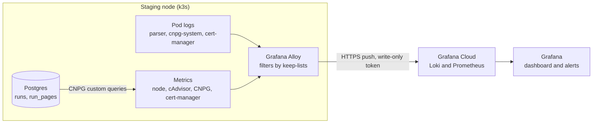

# ADR-0014: UKMA Data Staging Observability with Grafana Alloy and Grafana Cloud

## Status

Proposed

## Date

2026-11-11

## Context

UKMA Data runs on a single-node k3s cluster on staging ([ADR-0011](./0011-saz-data-service.md), [deployment spec](../../parser-service/deployment-infrastructure.md)). Its spec left observability as an open question. Today we learn about problems only by checking the node by hand over SSH, so a failed crawl, a full disk or an expiring certificate can go unnoticed for days.

**Forces:**

- **A small node.** One `cx23` VM (2 vCPU, 4 GB) already runs Postgres (1 GiB for two instances), the operators, Traefik, the API and the worker.
- **No new open ports.** The firewall allows only 22, 80 and 443.
- **Student data.** `page_snapshots.content` holds student lists. Telemetry that leaves the node may carry ids, paths, counts and error reasons, never page content.
- **Reviewed changes.** The repo is public, and the platform is applied only from CI after review. What we collect should change the same way.
- **No budget.** The service has no paid infrastructure beyond the VM.
- **Crawl health lives in the database.** The `runs` and `run_pages` tables already record every crawl; the parser code exposes no metrics.

## Decision

We will run one Grafana Alloy pod in a `monitoring` namespace that pushes logs and metrics to Grafana Cloud's free tier. Its manifests and its config (`config.alloy`) live in `infra/deploy/parser/k8s/platform/monitoring/`, and the Parser Platform workflow applies them like the rest of the platform.

Alloy collects:

- **Logs** of the `parser`, `cnpg-system` and `cert-manager` namespaces, read through the Kubernetes API.
- **Metrics** from the node, the containers (kubelet cAdvisor), the CNPG exporter and cert-manager. Each source has a keep-list of the metric names we use.
- **Crawl health** through CNPG custom queries on `runs` and `run_pages`. Postgres' `pg_monitor` role gets `SELECT` on these two tables only (parser migration `0003_monitoring_read`).

Alloy only pushes, with a token that can only write. We will not instrument the parser code for now.

## Consequences

* ✅ Logs, dashboards and alerts for staging, with no new ports and no storage to run ourselves.
* ✅ Every change to what we collect goes through a PR.
* ✅ About 128–384 MiB of memory for the whole setup.
* ✅ Crawl health without changing the parser code.
* ⚠️ Logs and metrics leave the node for a third party (Grafana Cloud, EU region). Log lines must keep following the parser's no-personal-data rule.
* ⚠️ Free tier limits: 14 days of retention and 10k active series. A new metric has to be added to a keep-list before it reaches Grafana.
* ⚠️ The crawl metrics depend on the table and column names. A migration that renames them silently empties the metrics.
* ⚠️ The node metrics need read-only hostPath mounts, so the `monitoring` namespace allows privileged pods.
* ❌ No per-request API latency or traces. That needs OTLP instrumentation in the parser later.
* ❌ Grafana's ready-made Kubernetes dashboards expect metrics we drop, so we maintain our own dashboard.
* ❌ Reading logs through the API can lose a few seconds of lines while Alloy restarts.

## Considered Alternatives

1. **Grafana's `k8s-monitoring` Helm chart, as offered by the Grafana Cloud onboarding.**
   - Pros: ready-made dashboards and alerts; upgrades maintained by Grafana.
   - Cons: as offered, it takes its config from Grafana Cloud (Fleet Management) instead of git, runs as root on the host network, and deploys several collectors plus kube-state-metrics and node-exporter. Helm is not part of our deploy pipeline.
   - Rejection Reason: collection would change without review, and it is too heavy for the node.

2. **Self-hosted metrics and logs in the cluster (VictoriaMetrics or Prometheus, Loki, Grafana).**
   - Pros: data never leaves the node; no external account.
   - Cons: 400–700 MiB more memory; storage on `local-path`, which does not enforce sizes; alerting to set up ourselves; the monitoring dies with the node it watches.
   - Rejection Reason: too much to run and too much memory for one small node.

3. **An uptime check and a scheduled status script over SSH only.**
   - Pros: no new components.
   - Cons: no history, dashboards or log search; the script needs SSH access to the node from CI.
   - Rejection Reason: catches "down", but not slow failures like a growing disk or a failing crawl.

4. **Instrument the parser with OpenTelemetry now.**
   - Pros: request latency, traces and crawl metrics straight from the code.
   - Cons: changes the parser for a proof of concept; the database already holds the crawl state.
   - Rejection Reason: deferred until the cluster-level setup has proved itself.
