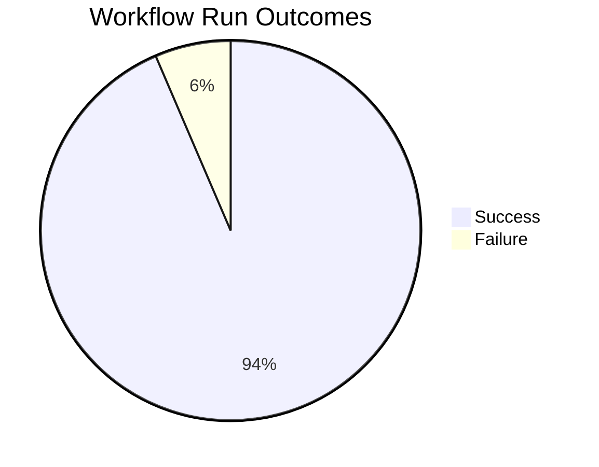
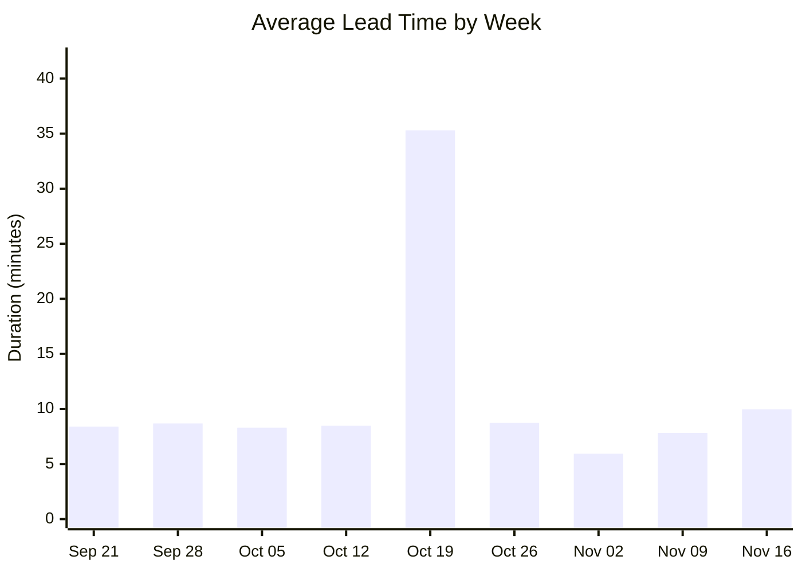
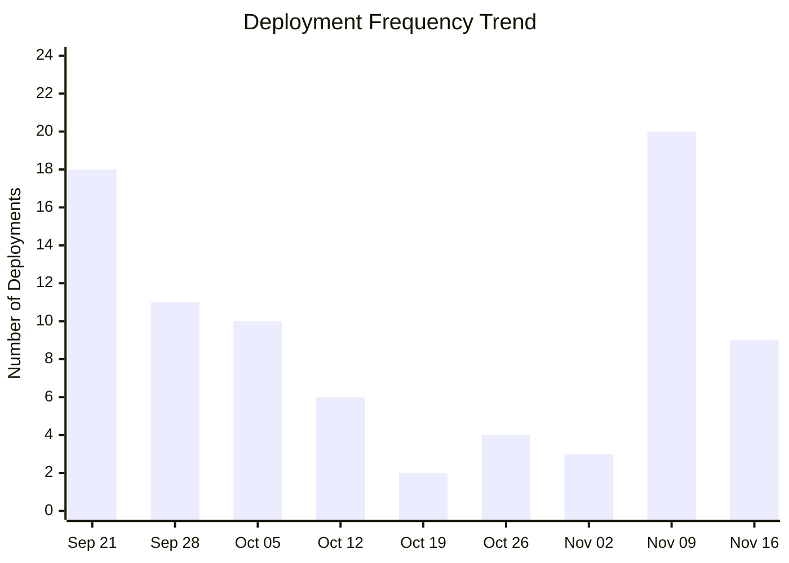
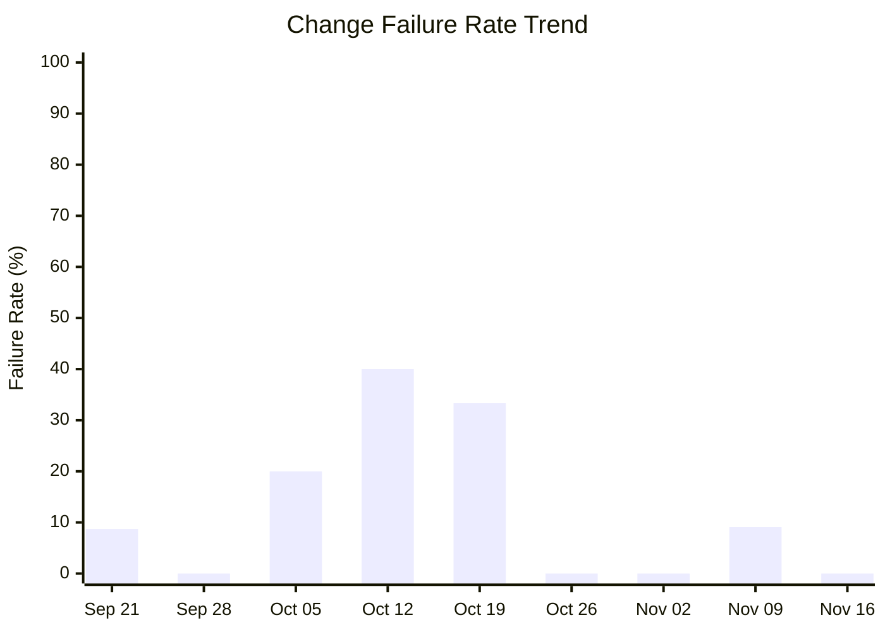

# DORA Metrics Report

**Generated:** 2026-11-17 17:59:57

## Summary

|Metric|Value|Category|
| --- | --- | --- |
| Deployment Frequency | 39.48/week | Elite |
| Lead Time for Changes | 8m 29s | Elite |
| Change Failure Rate | 6.5% | Elite |
| Time to Restore | 15h 28m | High |

**Total Runs:** 31 | **Successful:** 29 (93.5%) | **Failed:** 2 (6.5%)

---

## Visualizations

### Workflow Outcomes

### Lead Time Trend

| Week Starting | Avg Lead Time | Deployments |
|---------------|---------------|-------------|
| Sep 21 | 8m 24s | 18 |
| Sep 28 | 8m 41s | 11 |
| Oct 05 | 8m 18s | 10 |
| Oct 12 | 8m 28s | 6 |
| Oct 19 | 35m 18s | 2 |
| Oct 26 | 8m 45s | 4 |
| Nov 02 | 5m 56s | 3 |
| Nov 09 | 7m 49s | 20 |
| Nov 16 | 9m 58s | 9 |

### Deployment Frequency Trend

**Deployment Cadence Analysis:**
- **Average per week:** 9.2 deployments
- **Most active week:** 20 deployments
- **Least active week:** 2 deployments
- **Consistency:** Low (irregular release pattern)

### Change Failure Rate Trend

| Week Starting | Total Runs | Failed | CFR |
|---------------|------------|--------|-----|
| Sep 21 | 23 | 2 | 8.7% |
| Sep 28 | 11 | 0 | 0.0% |
| Oct 05 | 15 | 3 | 20.0% |
| Oct 12 | 10 | 4 | 40.0% |
| Oct 19 | 3 | 1 | 33.3% |
| Oct 26 | 4 | 0 | 0.0% |
| Nov 02 | 3 | 0 | 0.0% |
| Nov 09 | 22 | 2 | 9.1% |
| Nov 16 | 9 | 0 | 0.0% |
**DORA Performance Tiers:**
- Elite: ≤ 15%
- High: 16-30%
- Medium: 31-45%
- Low: > 45%