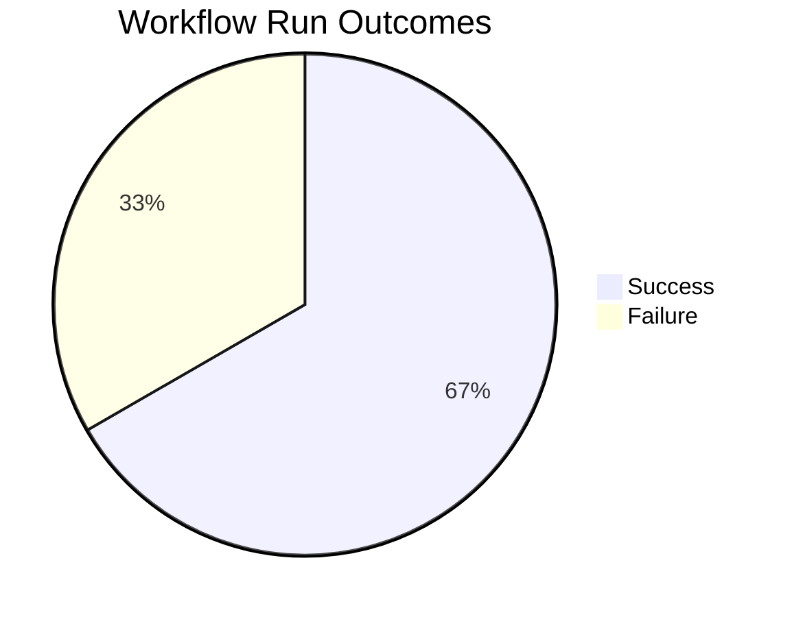
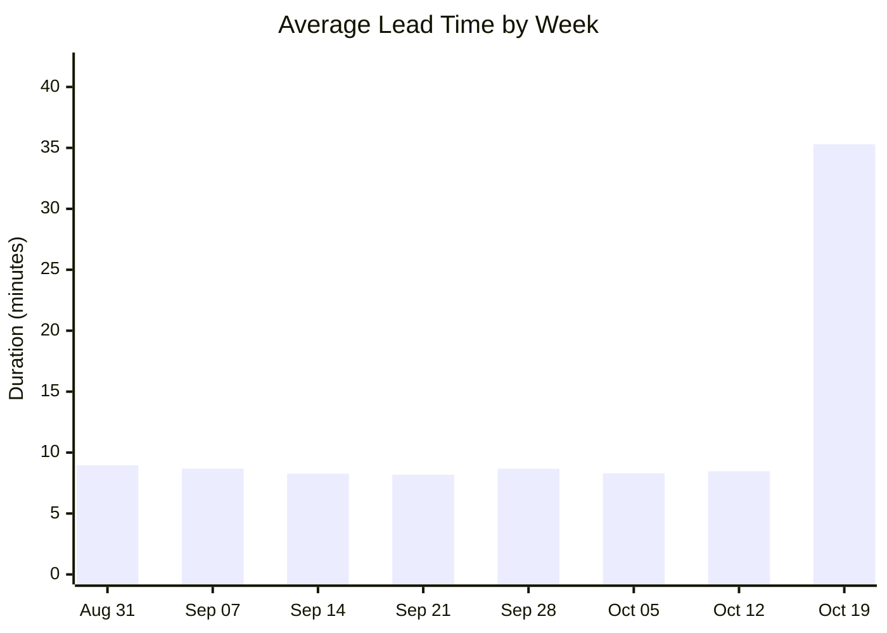
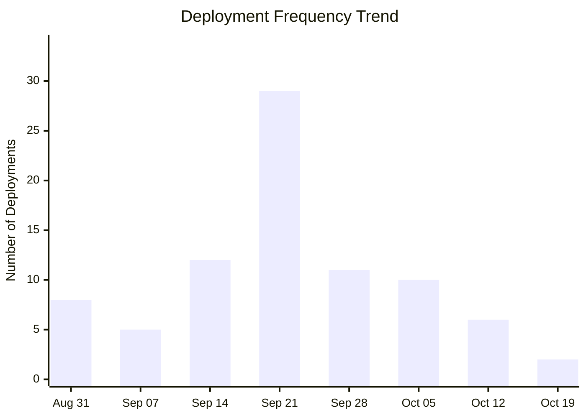
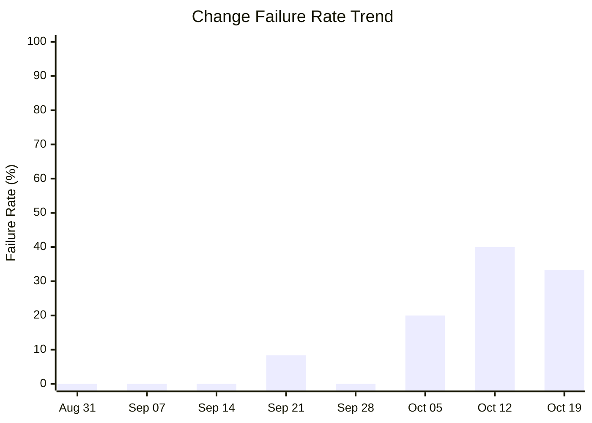

# DORA Metrics Report

**Generated:** 2026-10-27 09:06:20

## Summary

|Metric|Value|Category|
| --- | --- | --- |
| Deployment Frequency | 7.02/week | Elite |
| Lead Time for Changes | 35m 18s | Elite |
| Change Failure Rate | 33.3% | Medium |
| Time to Restore | 16h 49m | High |

**Total Runs:** 3 | **Successful:** 2 (66.7%) | **Failed:** 1 (33.3%)

---

## Visualizations

### Workflow Outcomes

### Lead Time Trend

| Week Starting | Avg Lead Time | Deployments |
|---------------|---------------|-------------|
| Aug 31 | 8m 57s | 8 |
| Sep 07 | 8m 41s | 5 |
| Sep 14 | 8m 16s | 12 |
| Sep 21 | 8m 11s | 29 |
| Sep 28 | 8m 41s | 11 |
| Oct 05 | 8m 18s | 10 |
| Oct 12 | 8m 28s | 6 |
| Oct 19 | 35m 18s | 2 |

### Deployment Frequency Trend

**Deployment Cadence Analysis:**
- **Average per week:** 10.4 deployments
- **Most active week:** 29 deployments
- **Least active week:** 2 deployments
- **Consistency:** Low (irregular release pattern)

### Change Failure Rate Trend

| Week Starting | Total Runs | Failed | CFR |
|---------------|------------|--------|-----|
| Aug 31 | 8 | 0 | 0.0% |
| Sep 07 | 5 | 0 | 0.0% |
| Sep 14 | 12 | 0 | 0.0% |
| Sep 21 | 36 | 3 | 8.3% |
| Sep 28 | 11 | 0 | 0.0% |
| Oct 05 | 15 | 3 | 20.0% |
| Oct 12 | 10 | 4 | 40.0% |
| Oct 19 | 3 | 1 | 33.3% |
**DORA Performance Tiers:**
- Elite: ≤ 15%
- High: 16-30%
- Medium: 31-45%
- Low: > 45%