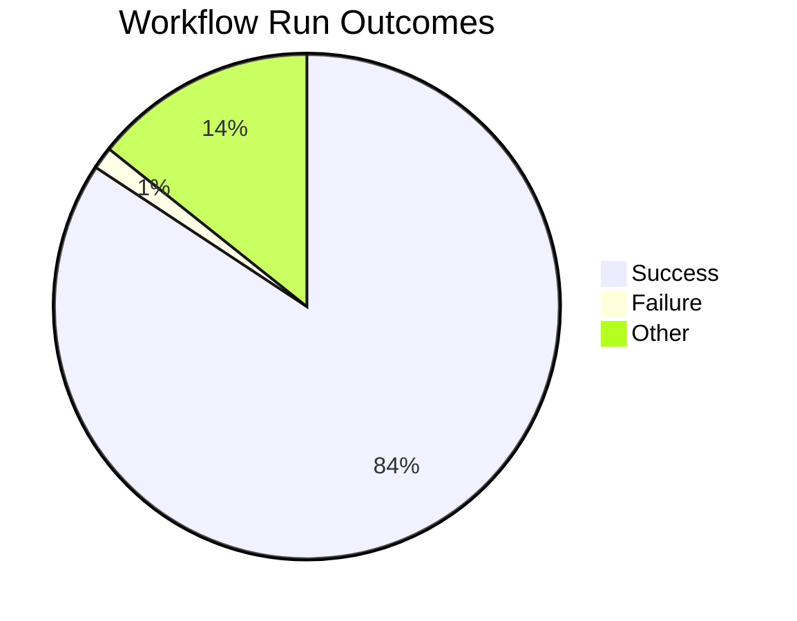
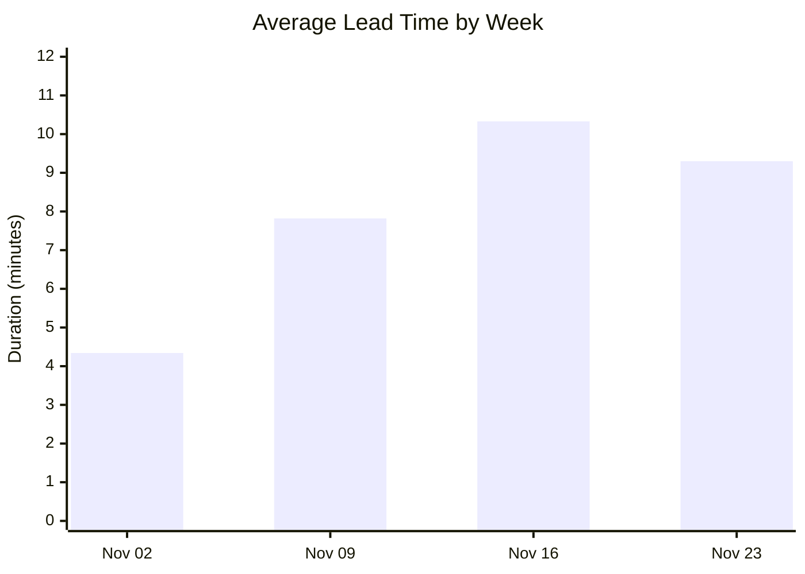
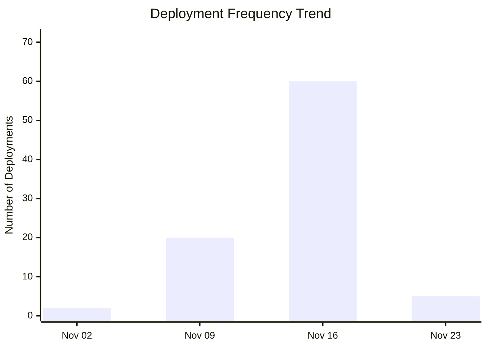
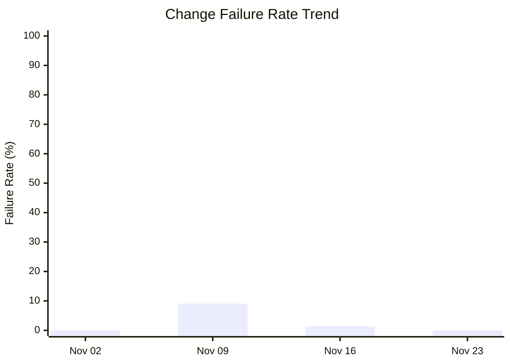

# DORA Metrics Report

**Generated:** 2026-11-24 09:03:34

## Summary

|Metric|Value|Category|
| --- | --- | --- |
| Deployment Frequency | 71.00/week | Elite |
| Lead Time for Changes | 10m 20s | Elite |
| Change Failure Rate | 1.7% | Elite |
| Time to Restore | 26m 27s | Elite |

**Total Runs:** 70 | **Successful:** 59 (84.3%) | **Failed:** 1 (1.4%) | **Other:** 10 (14.3%)

---

## Visualizations

### Workflow Outcomes

### Lead Time Trend

| Week Starting | Avg Lead Time | Deployments |
|---------------|---------------|-------------|
| Nov 02 | 4m 20s | 2 |
| Nov 09 | 7m 49s | 20 |
| Nov 16 | 10m 20s | 60 |
| Nov 23 | 9m 18s | 5 |

### Deployment Frequency Trend

**Deployment Cadence Analysis:**
- **Average per week:** 21.8 deployments
- **Most active week:** 60 deployments
- **Least active week:** 2 deployments
- **Consistency:** Low (irregular release pattern)

### Change Failure Rate Trend

| Week Starting | Total Runs | Failed | CFR |
|---------------|------------|--------|-----|
| Nov 02 | 2 | 0 | 0.0% |
| Nov 09 | 22 | 2 | 9.1% |
| Nov 16 | 71 | 1 | 1.4% |
| Nov 23 | 5 | 0 | 0.0% |
**DORA Performance Tiers:**
- Elite: ≤ 15%
- High: 16-30%
- Medium: 31-45%
- Low: > 45%