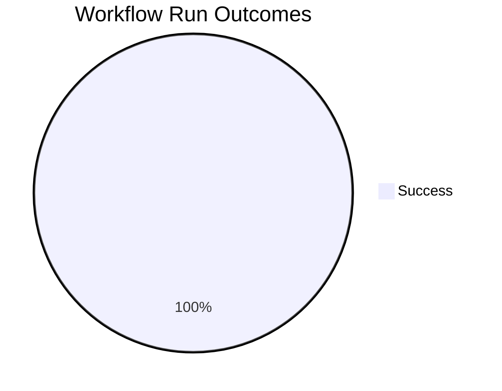
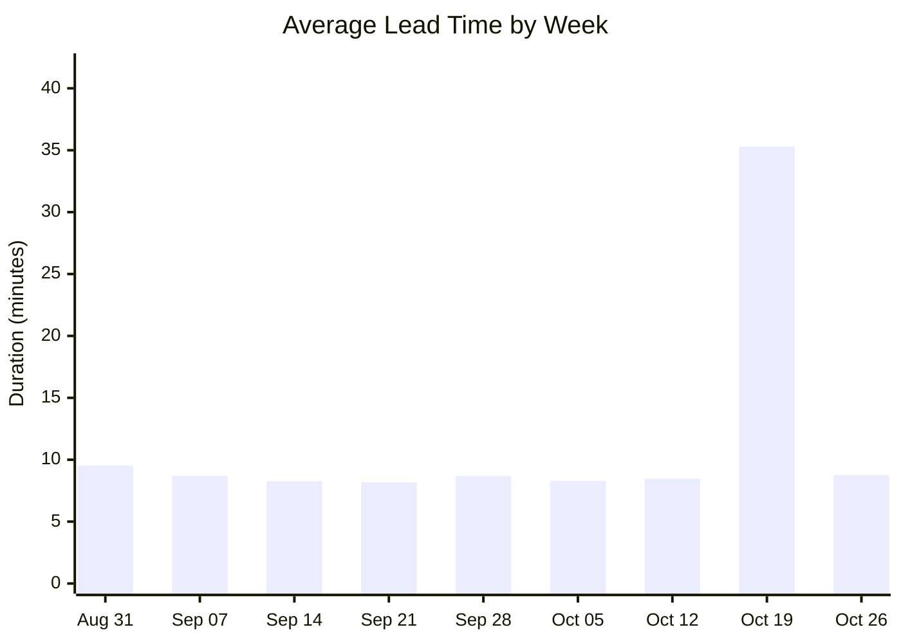
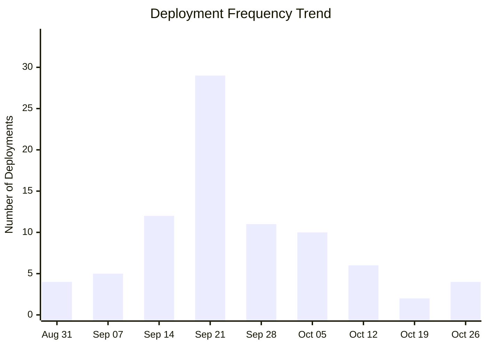
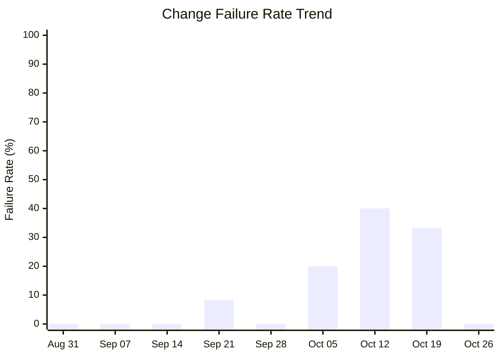

# DORA Metrics Report

**Generated:** 2026-11-03 09:03:24

## Summary

|Metric|Value|Category|
| --- | --- | --- |
| Deployment Frequency | 9.85/week | Elite |
| Lead Time for Changes | 8m 45s | Elite |
| Change Failure Rate | 0.0% | Elite |
| Time to Restore | 16h 49m | High |

**Total Runs:** 4 | **Successful:** 4 (100.0%) | **Failed:** 0 (0.0%)

---

## Visualizations

### Workflow Outcomes

### Lead Time Trend

| Week Starting | Avg Lead Time | Deployments |
|---------------|---------------|-------------|
| Aug 31 | 9m 31s | 4 |
| Sep 07 | 8m 41s | 5 |
| Sep 14 | 8m 16s | 12 |
| Sep 21 | 8m 11s | 29 |
| Sep 28 | 8m 41s | 11 |
| Oct 05 | 8m 18s | 10 |
| Oct 12 | 8m 28s | 6 |
| Oct 19 | 35m 18s | 2 |
| Oct 26 | 8m 45s | 4 |

### Deployment Frequency Trend

**Deployment Cadence Analysis:**
- **Average per week:** 9.2 deployments
- **Most active week:** 29 deployments
- **Least active week:** 2 deployments
- **Consistency:** Low (irregular release pattern)

### Change Failure Rate Trend

| Week Starting | Total Runs | Failed | CFR |
|---------------|------------|--------|-----|
| Aug 31 | 4 | 0 | 0.0% |
| Sep 07 | 5 | 0 | 0.0% |
| Sep 14 | 12 | 0 | 0.0% |
| Sep 21 | 36 | 3 | 8.3% |
| Sep 28 | 11 | 0 | 0.0% |
| Oct 05 | 15 | 3 | 20.0% |
| Oct 12 | 10 | 4 | 40.0% |
| Oct 19 | 3 | 1 | 33.3% |
| Oct 26 | 4 | 0 | 0.0% |
**DORA Performance Tiers:**
- Elite: ≤ 15%
- High: 16-30%
- Medium: 31-45%
- Low: > 45%