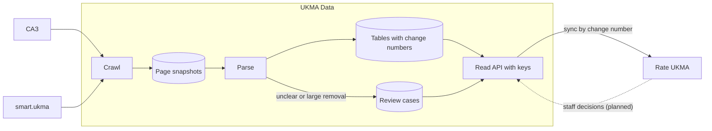

# UKMA Data overview

UKMA Data crawls NaUKMA's САЗ and smart.ukma on a schedule and stores every page it reads; САЗ pages are parsed into tables. Readers such as Rate UKMA sync those tables over an HTTP API with keys.

> **Status.** `main` has only the crawl of САЗ pages into snapshots, the worker, the database layer and a `/health` endpoint. Everything else on this page, from parsing to the keyed read API, is open in a pull request, marked below as `(#NNN)`, and is not on `main` yet.

## Modules

Folders under `src/parser/src`:

| Folder | Job |
| --- | --- |
| `saz/` | Fetch САЗ pages (`SazClient`) on `main`; the page parsers are pure functions with fixtures: course pages (#784), students pages (#792). |
| `crawl/` | Plan runs, claim pages and store page snapshots. |
| `smart/`, `microsoft/` | Sign in to smart.ukma and store its lists as snapshots (#787). |
| `offerings/` | Write offerings, terms and programmes from snapshots (#784); reparse stored snapshots (#785); mark removals and hold large ones (#788). |
| `students/` | Write students and enrollments from students pages (#792). |
| `changes/` | Give every write the next change number, one writer at a time (#801). |
| `lists/` | Read each list above a change number, page by page (#791). |
| `keys/`, `audit/` | API keys and scopes; the log of keyed requests and key changes (#790). |
| `api/` | HTTP endpoints: `/health` on `main`; the keyed `/v1` read API and the generated OpenAPI file come with #791. |
| `worker/` | The background loop that runs crawls; it parses too once #784 lands. |
| `db/` | Postgres layer, migrations, lock keys and the test database. |

## Rules that matter most

1. **Store raw pages first, parse later.** A crawl only saves page snapshots. Parsing reads snapshots, so a parser fix reparses old pages without a new crawl.
2. **Every change gets a number.** Writes take turns on one counter, so numbers commit in order. A reader saves the last number per list and asks for rows above it; it never syncs by time.
3. **Nothing is deleted, with one exception.** A row that leaves its source gets `removed_at`. The exception: every parse of an offering's card replaces that offering's term and programme rows. A run that would remove more than the threshold (5% by default) holds those removals as a review case for staff.
4. **Personal data has known places.** Students (names, email) and instructors (`full_name`, `email`) are personal tables, and page snapshots carry student names, so a key needs its own scope to read them. Logs and the audit log carry ids and counts, never names, emails or page content.
5. **SQL is tested on real Postgres.** Store tests use `TestDatabase`; CI fails when `TEST_DATABASE_URL` is missing.

## Read next

- [spec.md](spec.md): scope, decisions, glossary and the full rule list.
- [schema.md](schema.md): every table and column.
- [edge-cases.md](edge-cases.md): САЗ page variations and where each is handled.
- [deployment-infrastructure.md](deployment-infrastructure.md): how the service is deployed to staging and production.
- [infra/deploy/parser/README.md](../../infra/deploy/parser/README.md): the Terraform and Kubernetes config, file by file.
- [src/parser/AGENTS.md](../../src/parser/AGENTS.md): how to run the service and code conventions.
