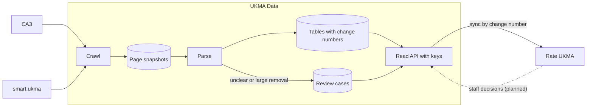

# UKMA Data overview

UKMA Data crawls NaUKMA's САЗ and smart.ukma on a schedule and stores every page it reads; САЗ pages are parsed into tables. Readers such as Rate UKMA sync those tables over an HTTP API with keys.

## Modules

Folders under `src/parser/src`:

| Folder | Job |
| --- | --- |
| `saz/` | Fetch САЗ pages (`SazClient`); the parsers are pure functions with fixtures. |
| `crawl/` | Plan runs, claim pages and store page snapshots. |
| `smart/`, `microsoft/` | Sign in to smart.ukma and store its lists as snapshots (#787). |
| `offerings/` | Write offerings, terms and programmes from snapshots; mark removals and hold large ones. |
| `students/` | Write students and enrollments from students pages. |
| `changes/` | Give every write the next change number, one writer at a time. |
| `lists/` | Read each list above a change number, page by page. |
| `keys/`, `audit/` | API keys and scopes; the log of keyed requests and key changes. |
| `api/` | HTTP endpoints and the generated OpenAPI file. |
| `worker/` | The background loop that runs crawls and parses. |
| `db/` | Postgres layer, migrations, lock keys and the test database. |

## Rules that matter most

1. **Store raw pages first, parse later.** A crawl only saves page snapshots. Parsing reads snapshots, so a parser fix reparses old pages without a new crawl.
2. **Every change gets a number.** Writes take turns on one counter, so numbers commit in order. A reader saves the last number per list and asks for rows above it; it never syncs by time.
3. **Nothing is deleted.** A row that leaves its source gets `removed_at`. A run that would remove more than the threshold (5% by default) holds those removals as a review case for staff.
4. **Personal data stays in one place.** Only the `students` table holds personal fields. Logs and the audit log carry ids and counts, never names, emails or page content.
5. **SQL is tested on real Postgres.** Store tests use `TestDatabase`; CI fails when `TEST_DATABASE_URL` is missing.

## Read next

- [spec.md](spec.md): scope, decisions, glossary and the full rule list.
- [schema.md](schema.md): every table and column.
- [edge-cases.md](edge-cases.md): САЗ page variations and where each is handled.
- [src/parser/AGENTS.md](../../src/parser/AGENTS.md): how to run the service and code conventions.
