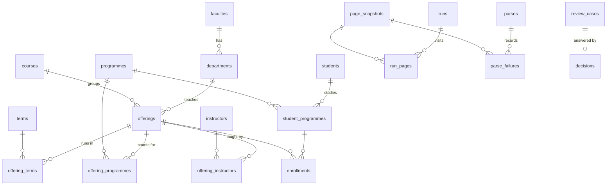

# UKMA Data schema

The Postgres tables for the whole [spec](spec.md), drafted from the [САЗ edge cases](edge-cases.md). Rule numbers point to the spec's [Rules](spec.md#rules). Table and column names are a draft for #763 to #768; the migrations may rename them, the shape should hold.

## Conventions

- **Ids.** Every row a reader sees has `id text`: a type prefix and a ULID, for example `off_01JA2B3C4D5E6F7G8H9J0K1M2N`. Ids never change and carry no meaning (rule 1). The САЗ code, a smart.ukma id or a `cdoc` sits in its own `saz_*` or `smart_*` column as a lookup key. `runs`, `run_pages` and `page_snapshots` keep their `bigint` keys from #761; the API shows them as `run_<n>` and `snp_<n>`.
- **Change numbers.** Every list a reader syncs has `change_no bigint`. A write takes `pg_advisory_xact_lock` on one fixed key, then `nextval('change_no_seq')`, and holds the lock until it commits, so writes take turns and the numbers commit in order (rule 5). Each list has an index on `change_no`. A row takes a number only when its content changed; for an offering, `row_hash` covers its card, terms and programmes, and a faculty or department that now resolves to another row also counts. A trigger on each list fails a statement that writes `change_no` without the lock. Rows stored before change numbers have `add` trail rows with no run or parse. Their `row_hash` starts empty, because SQL cannot compute it, so the first parse after migration 0005 renumbers every stored offering once.
- **Removal.** Rows that come from a source have `removed_at timestamptz` and are never deleted (rule 4). A row that comes back gets `removed_at = null` and a new change number.
- **API names.** Columns are snake_case; the API shows them in camelCase (`removedAt`, `mergedInto`, `changeNo`).
- **Read and derived.** Columns read from a page are rewritten by every parse. Derived columns (marked "derived" below) are written only by the matching step from stored data plus decisions (rule 8).
- **Child rows.** An offering's terms and programmes are part of the offering: a change to them gives the offering a new change number. They have no `change_no` or `removed_at` of their own: every parse of the card replaces them (rule 4).

## Reference lists

### `terms`

One season of one academic year (glossary: Term).

| Column | Type | Notes |
| --- | --- | --- |
| `id` | text | `trm_...` |
| `code` | text unique | `2026-27-FALL`; seasons `FALL`, `SPRING`, `SUMMER` |
| `academic_year` | smallint | first calendar year, `2026` |
| `season` | text | `FALL` from `Осінь`, `SPRING` from `Весна`, `SUMMER` from `Літо` |
| `change_no` | bigint | |

Terms are never removed.

### `faculties`, `departments`

| Column | Type | Notes |
| --- | --- | --- |
| `id` | text | `fac_...`, `dep_...` |
| `name` | text unique | as on the card, whitespace collapsed |
| `saz_filter_id` | text null | the catalog filter option value (`filter[faculty][]`, `filter[subfaculty][]`), matched by name |
| `faculty_id` | text | departments only |
| `change_no`, `removed_at` | | |

### `programmes`

| Column | Type | Notes |
| --- | --- | --- |
| `id` | text | `prg_...` |
| `name` | text | as on the card or in a students list |
| `level` | text | `bachelor`, `master`, from the catalog filter (D12) |
| `saz_filter_id` | text null | `filter[spec][]` option value; 8 card programmes have none |
| `change_no`, `removed_at` | | |

Unique on (`name`, `level`): 30 names exist at both levels (D12). A card names a programme without its level, so the catalog filter `Name (Бакалавр)` or `Name (Магістр)` gives it, the card's level first; a name the filter does not list keeps the level of a stored programme of that name, else takes the card's level. A students list also names a programme without its level: a programme record takes the programme of that name on the cards of its offerings.

## Catalog

### `offerings`

One САЗ card (glossary: Offering).

| Column | Type | Notes |
| --- | --- | --- |
| `id` | text | `off_...` |
| `saz_code` | text unique | never reused across years (A8) |
| `academic_year` | smallint | from `Навчальний рік` |
| `title` | text | unescaped, whitespace collapsed (B16) |
| `faculty_id`, `department_id` | text null | null when the card has no `Факультет` and `Кафедра` rows (B18) |
| `level` | text | `bachelor`, `master` (B17) |
| `is_recommended` | boolean | false when the catalog card is `panel-danger`, "не рекомендовано" (A1) |
| `format` | text | `2015` on every card so far |
| `credits` | numeric(4,1) | 0 allowed (B4) |
| `hours` | integer | |
| `study_year` | smallint | the card's `N рік` |
| `status` | text | `held`, `not_held`, `may_hold`, `unknown` (B2) |
| `is_practical` | boolean | `Практичний` label (B3) |
| `annotation` | text null | (B15) |
| `saz_teachers` | text null | the `Викладач` cell as read, null when empty (B1); a hint for #767, not a link |
| `max_students`, `max_groups`, `computed_max_students` | integer null | null is `необмежено` (B12) |
| `group_size_min`, `group_size_max` | integer | |
| `enrolled_active` | integer null | the card count; null without the enrollment block (B13, B14) |
| `snapshot_id` | bigint | the course page this row was last parsed from |
| `course_id` | text | derived: the course group |
| `course_source` | text | derived: `rule` or `decision` |
| `change_no`, `removed_at` | | |

### `offering_terms`

| Column | Type | Notes |
| --- | --- | --- |
| `offering_id` | text | |
| `term_id` | text | from the season row and the offering's year |
| `semesters` | smallint[] | the `Семестр N` labels of this season, `Nд` as N (B8) |
| `credits` | numeric(4,1) | the term's credits, not reconciled with the card (B5) |
| `hours_per_week`, `lecture_hours`, `seminar_hours`, `practice_hours` | integer null | the label text; lecture, seminar and practice are term totals (B10) |
| `control` | text null | `pass_fail` (`залік`), `exam` (`екзамен`), `thesis` (`теза`), `none` (`не має контролю`), `thesis_defence` (`захист дипломної роботи`); null when the label is empty (B10) |

Key (`offering_id`, `term_id`). An offering may have no terms (B7).

### `offering_programmes`

| Column | Type | Notes |
| --- | --- | --- |
| `offering_id`, `programme_id` | text | key; a repeated row collapses (B11) |
| `kind` | text | `compulsory`, `prof_oriented`, `elective` |

### `courses`

Offerings of one subject across years (glossary: Course).

| Column | Type | Notes |
| --- | --- | --- |
| `id` | text | `crs_...` |
| `title` | text | derived: from the latest offering |
| `department_id` | text null | derived: from the latest offering, null when it has none (B18) |
| `level` | text | |
| `merged_into` | text null | the course that now holds its offerings (rule 10) |
| `change_no`, `removed_at` | | `removed_at` is set by a merge or when no offering is left |

A merge sets `removed_at` and `merged_into` on the old course and moves its offerings, so each moved offering gets a new change number. A reader that holds the old id follows `merged_into`.

## Instructors

### `instructors`

| Column | Type | Notes |
| --- | --- | --- |
| `id` | text | `ins_...` |
| `smart_id` | text unique | smart.ukma's own id |
| `full_name`, `email` | text | |
| `department_id` | text null | |
| `change_no`, `removed_at` | | |

### `offering_instructors`

Derived links, a list of their own.

| Column | Type | Notes |
| --- | --- | --- |
| `id` | text | `oin_...` |
| `offering_id`, `instructor_id` | text | unique together |
| `source` | text | `rule` or `decision` |
| `decision_id` | text null | |
| `change_no`, `removed_at` | | an unlinked teacher keeps the row with `removed_at` set |

## Students

### `students`

A person (glossary: Student).

| Column | Type | Notes |
| --- | --- | --- |
| `id` | text | `stu_...` |
| `email` | text null unique | lower-case (D5); null for the few records with none (D3) |
| `full_name` | text | whitespace collapsed; set by the latest list, but a name with `*` never replaces one without it (D6, D7) |
| `last_name`, `first_name`, `patronymic` | text null | filled only when the name has three words |
| `change_no`, `removed_at` | | removed when no enrollment of the person is left |

A student is found by email, else by `cdoc`, never by name (D7). When a `cdoc` shows a new email, the latest list wins and the record moves to that student (D1).

### `student_programmes`

One `cdoc`: a student on one programme (D1).

| Column | Type | Notes |
| --- | --- | --- |
| `id` | text | `spr_...` |
| `saz_cdoc` | text unique | |
| `student_id` | text | |
| `programme_id` | text null | the programme named `specName` on the cards of the record's offerings; null when those cards name it at both levels (D12) |
| `change_no`, `removed_at` | | removed when no enrollment of the record is left |

### `enrollments`

| Column | Type | Notes |
| --- | --- | --- |
| `id` | text | `enr_...` |
| `offering_id`, `student_programme_id` | text | unique together; one person can be on a list twice (D2) |
| `kind` | text | `compulsory`, `prof_oriented`, `elective` from `type` (D11) |
| `status` | text | `enrolled` (10) or `unenrolled` (-10) |
| `student_state` | text | `enrolled`, `not_studying`, `dropped`, `forced` from `statusLabel` (D8) |
| `is_forced` | boolean | |
| `group_no` | smallint null | (D9) |
| `grade` | smallint | the student's year of study then |
| `saz_created_at`, `saz_updated_at` | timestamptz null | null when САЗ sends 0 (D10) |
| `snapshot_id` | bigint | the students page this row was last parsed from |
| `change_no`, `removed_at` | | |

## Runs and pages

`runs`, `run_pages` and `page_snapshots` exist since #761 (`0002_saz_snapshots`). The columns below are added.

| Table | New column | Type | Notes |
| --- | --- | --- | --- |
| `runs` | `trigger` | text | `schedule` or `key` |
| | `key_id` | text null | the key that asked for an extra run |
| | `offering_removals` | text | `applied`, `held` or `skipped` (see below) |
| | `lists_kept` | integer | offerings whose students page failed, so their enrollments were kept |
| `run_pages` | `http_status` | smallint null | 500 for the A2 pages |

A page that fails to parse keeps its last good rows, and `offerings.snapshot_id` still points at the snapshot they came from (rule 6).

Each parse of the stored pages, after a crawl or from the `reparse` command, adds a `parses` row (`trigger` `crawl` or `reparse`, `started_at`, `finished_at`, and a `report` with the pages parsed and the failures counted by reason). Each page that fails adds a `parse_failures` row with the parse, the snapshot, the path and the reason. A `parses` row with no `finished_at` is a parse that is running or crashed. `reparse` parses the latest snapshot of every course page again, so no parser version is kept (rule 2).

### `changes`

The trail of each run and decision (rule 11).

| Column | Type | Notes |
| --- | --- | --- |
| `change_no` | bigint | key; the number the row got |
| `table_name`, `row_id` | text | |
| `action` | text | `add`, `change`, `remove`, `restore` |
| `run_id` | bigint null | the run whose removal step removed the row |
| `parse_id` | bigint null | the parse that added, changed or restored the row; a parse publishes what a crawl fetched, so a run's added and changed rows are those of the parse after it |
| `decision_id` | text null | |
| `at` | timestamptz | |

Each parse's `report` counts its rows by table and action. A removed offering comes back only when a run fetches its page after the removal: its last snapshot stays the latest of its path, so a reparse alone does not restore it, and until then it keeps the content of its last parse. A run that holds the same removals as the year's open `removals_held` case keeps that case. A department keeps the faculty it was first stored with. Faculties, departments and programmes are not removed yet.

## Review cases and decisions

### `review_cases`

| Column | Type | Notes |
| --- | --- | --- |
| `id` | text | `rev_...` |
| `kind` | text | `course_match`, `instructor_match`, `removals_held` |
| `subject_id` | text | the offering, or the run for held removals |
| `candidates` | jsonb | ids only: courses, instructors, or the rows the run would remove |
| `safe_answer` | jsonb | what was published |
| `status` | text | `open`, `decided`, `obsolete` (a later run made it moot) |
| `run_id` | bigint | the run that opened it |
| `decision_id` | text null | |
| `opened_at` | timestamptz | |
| `change_no` | bigint | |

### `decisions`

| Column | Type | Notes |
| --- | --- | --- |
| `id` | text | `dec_...` |
| `kind` | text | `merge`, `keep_apart`, `split`, `link_instructor`, `keep_unlinked`, `apply_removals`, `drop_removals` |
| `review_case_id` | text null | null when staff start it, for example a split |
| `payload` | jsonb | ids the decision acts on |
| `reverses_id` | text null | an earlier decision it undoes (rule 10) |
| `key_id` | text | |
| `staff_user` | text null | Rate UKMA's superuser id, not a name |
| `made_at` | timestamptz | |
| `change_no` | bigint | |

A decision wins over the matching rules, so the matching step reads the latest non-reversed decision for each offering before it applies a rule.

## Keys and audit log

### `api_keys`

| Column | Type | Notes |
| --- | --- | --- |
| `id` | text | `key_...` |
| `name` | text | |
| `secret_hash` | text | the key is shown once |
| `scopes` | text[] | |
| `created_by` | text null | the key that made it; null for the first, made on the command line |
| `created_at`, `expires_at`, `revoked_at` | timestamptz | |

### `audit_log`

| Column | Type | Notes |
| --- | --- | --- |
| `id` | text | `aud_...` |
| `at` | timestamptz | |
| `key_id` | text | |
| `staff_user` | text null | |
| `action` | text | `key_created`, `key_revoked`, `run_started`, `decision_made`, `students_read`, `snapshots_read` |
| `target_id` | text null | |
| `row_count` | integer null | rows returned for a read; no data values |

## When a run may remove rows

Decided 2026-10-17, spec rule 6: one removal scope per list, not per run. САЗ fails on every attempt at 456 students pages of 2018-19 to 2022-23 (A2), so a rule that needs the whole run without errors would never remove anything in those five years.

- Offerings of a year, with their term and programme rows: removed when every catalog page and every course page of the run loaded. A page that loaded but failed to parse counts as not loaded. A failed students page does not block them. The removal threshold is a setting, 5% of the year's offerings to start: if the run would remove more, it holds the removals as a `removals_held` review case. Faculties, departments and programmes are not removed in the first release.
- Enrollments of one offering: replaced only when that offering's students page loaded in the run. A failed page keeps the offering's last good enrollments, or none.
- `runs.offering_removals` is `applied`, `held` when a review case holds them, or `skipped` when a catalog or course page failed or when the distinct course codes the run saw differ from the total page 1 of its catalog reported (a course that leaves mid-run shifts one card onto a page already read); `runs.report.removalsSkipped` says why. `runs.lists_kept` counts the offerings whose enrollments the run kept.

For example, the run for 2020-21 loads every catalog and course page and fails on 139 students pages. It may remove 2020-21 offerings that left the catalog, and it publishes no enrollments for the 139 offerings until САЗ serves their lists.

Rejected: a list of known failures that staff accept, which kept the old rule 6 but added a table and a staff step, and a page on the list could never remove its rows.
