<style>
section > p > img { display: block; margin: 6px auto 10px; max-width: 100%; }
pre code { font-size: 21px; line-height: 1.5; }
pre { padding: 18px 22px; }
code { font-size: 0.92em; background: var(--soft); color: var(--ink); padding: 1px 6px; border-radius: 6px; }
pre code { padding: 0; }
.doing { font-size: 24px; }
.terms td, .terms th { padding-top: 7px; padding-bottom: 7px; }
.terms table { font-size: 20px; }
</style>

<!-- _class: lead -->
<!-- _paginate: false -->

<div class="wordmark"><span>Rate <strong>UKMA</strong></span></div>

# Deployment infrastructure

<p class="small muted">UKMA Data on Kubernetes</p>

<!--
Today we'll walk through how our new service, UKMA Data, is deployed. I don't expect any Kubernetes experience. We introduce each concept on its own, then look straight away at how it appears in our repository. All the configs live in the infra/deploy/parser folder.
-->

---

## Two services, two setups

<div class="cols">
<div class="card">

### Rate UKMA

- Docker Compose on a VM
- live and staging
- nginx and Certbot

</div>
<div class="card pick">

### UKMA Data

- Kubernetes on a VM
- staging only for now
- Traefik and operators

</div>
</div>

<p class="doing">The rest of this talk is about UKMA Data only.</p>

<!--
To avoid confusion: the main Rate UKMA app hasn't moved anywhere. It runs on Docker Compose, with one virtual machine per environment, and it's updated over SSH.

UKMA Data is a separate service that collects SAZ data. It has its own database, its own release cycle and its own cluster. Kubernetes applies only to this service.
-->

---

## The main idea of Kubernetes

<p class="big">We describe the desired state. Kubernetes gets the cluster there.</p>

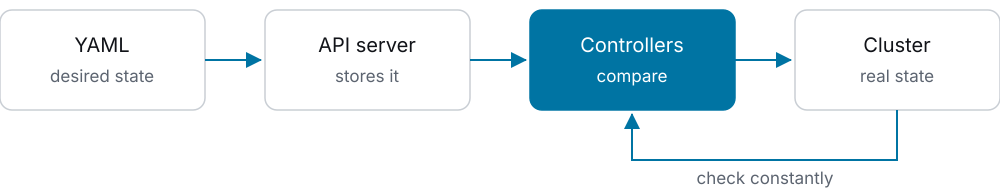

<p class="doing">Our configs contain no "start" or "restart" commands.</p>

<!--
This is the most important slide. If you remember one thing, make it this.

With Docker Compose we say: perform this action. With Kubernetes we say: there must be one pod of this image. That description goes to the API server, the central point of the cluster.

Then the controllers take over. These are programs that compare the desired state with the real state in a loop, and if the two differ, they fix the real state. The loop doesn't stop after a deploy. If something crashes tomorrow night, a controller sees it and fixes it.

Every object we discuss from here on is a record of desired state.
-->

---

## Node and cluster

<p class="big">A node is a machine. A cluster is nodes plus a control plane.</p>

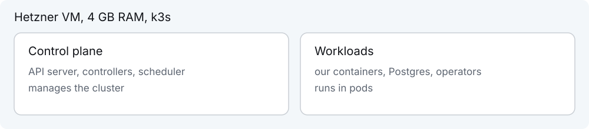

<p class="doing">Everything we run is on one node. k3s is a lightweight Kubernetes distribution.</p>

<!--
Usually the control plane and the workload containers live on different machines. We have one node, so everything sits on one Hetzner virtual machine with four gigabytes of memory.

k3s is full Kubernetes packaged as a single binary. It uses less memory, so it suits a machine like this. For our configs there's no difference: it's the same API.

Terraform creates this machine, and k3s is installed on first boot through cloud-init.
-->

---

## Pod

<p class="big">The smallest unit you can run: a container with its own IP.</p>

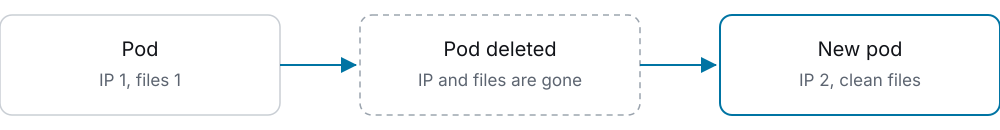

<p class="doing">A pod is temporary. You can't rely on any single pod.</p>

<!--
Kubernetes doesn't run containers directly, it runs pods. A pod can hold several containers, but ours all have one, so for us a pod is nearly the same thing as a container.

The key property: a pod is temporary. If only the container crashes, Kubernetes restarts it inside the same pod. But when a pod is deleted, for example during an update, a new one takes its place, with a different IP and a clean filesystem.

The next slides follow from this. Something has to create new pods, and that's a Deployment. Something has to provide a stable address, and that's a Service.
-->

---

## Deployment and ReplicaSet

<p class="big">We don't create pods by hand. We write a Deployment.</p>

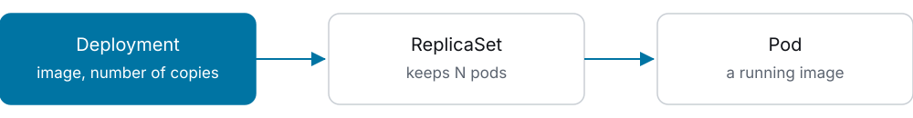

<p class="doing">Pod gone: the ReplicaSet creates a new one. We never write ReplicaSets.</p>

<!--
Here's the first answer to the question of who creates new pods.

In a Deployment we write which image to run and how many copies to keep. We keep one copy everywhere, that's the replicas field.

The Deployment creates a ReplicaSet by itself. The ReplicaSet has a simple job: keep the right number of pods. If there are too few, it creates another. This is the same controller loop from slide three.

Why two objects? A ReplicaSet covers one version. The Deployment manages the move between versions. That's the next slide.
-->

---

## Updating a Deployment

<p class="big">The old pod keeps running until the new one is ready.</p>

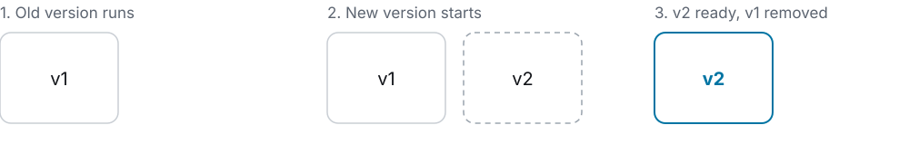

<p class="doing">A readiness probe checks this: <code>GET /health</code> every 5 s.</p>

<!--
When the image changes, the Deployment creates a new ReplicaSet and moves pods over to it step by step. This is called a rolling update.

We have one copy, so it looks like this: a new pod starts while the old one is still running. Every five seconds Kubernetes calls the health endpoint on the new pod. Once it answers successfully, traffic goes to the new pod and the old one is removed.

If the new version fails to start, the old pod keeps running. There's no downtime.

There's also a liveness probe: it checks a container that's already running and restarts it after three failed checks in a row.
-->

---

## Our workloads

<p class="big">One image, three commands.</p>

| Object           | Type       | Job                   | Update          |
| ---------------- | ---------- | --------------------- | --------------- |
| `parser-api`     | Deployment | HTTP API on port 8080 | rolling         |
| `parser-worker`  | Deployment | collects SAZ data     | Recreate        |
| `parser-migrate` | Job        | database migrations   | once per deploy |

<p class="doing">Recreate stops the old pod first, so two workers never run together.</p>

<!--
Here's how it looks for us. There's one parser image, and it starts with different arguments: api, worker or migrate.

The API updates step by step, as on the previous slide.

The worker updates differently, with the Recreate strategy. The old one stops first, then the new one starts. Two workers at once would run the same scheduled job, so a short gap is better than an overlap.

The third object has a different type: Job. That's next.
-->

---

## Job

<p class="big">A pod meant to finish. A Deployment would restart it forever.</p>

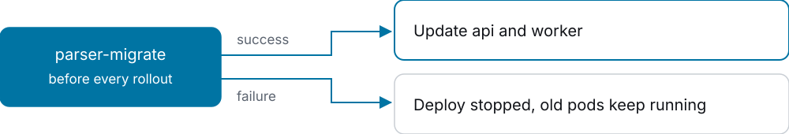

<p class="doing">One attempt, 5 min limit.</p>

<!--
A Job runs a pod to completion. A database migration is a perfect fit: it has to run once and exit.

The migration runs before the app is updated. If it fails, the deploy stops and the old pods keep serving requests. Nothing is broken.

There are no retries: backoffLimit is zero. The time limit is three hundred seconds.

One unusual detail: a Job can't be updated. So every deploy deletes the previous Job and creates a new one.
-->

---

## Service

<p class="big">A pod's IP changes. A Service's address stays the same.</p>

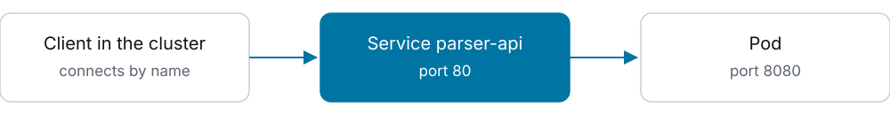

<p class="doing">A Service finds pods by label, not by IP. It's visible only inside the cluster.</p>

<!--
The second problem with temporary pods: how do you reach them if their IP keeps changing?

A Service is a permanent name and address inside the cluster. It points at pods through a label. A pod with the label component api automatically receives traffic, and an old pod drops off the list. So nothing in the config changes during an update.

The readiness probe matters here too: until a pod is ready, the Service sends it no traffic.

The limitation: this address works only inside the cluster. Access from outside needs the next object.
-->

---

## Ingress

<p class="big">A rule: which domain leads to which Service.</p>

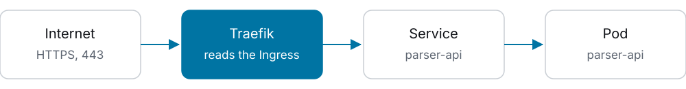

<p class="doing">An Ingress is only a record. Traefik, built into k3s, carries it out.</p>

<!--
An Ingress is a rule: send requests for the domain data.staging.rateukma.com, path slash, to the Service parser-api.

It's important to separate the rule from what executes it. An Ingress does nothing by itself. It's read by an ingress controller, which for us is Traefik. Traefik is a regular proxy running in the cluster, and it does the job nginx does in the main app.

k3s ships with Traefik, so we didn't install it separately. We accept HTTPS only, so a client can't send its API key in plain text.
-->

---

## Secret

<p class="big">Passwords and keys are kept apart from the YAML.</p>

| Secret             | Created by      | Contains       |
| ------------------ | --------------- | --------------- |
| `parser-db-app`    | CloudNativePG   | `DATABASE_URL`  |
| `parser-saz`       | Parser Platform | SAZ account     |
| `parser-ghcr-pull` | Parser Platform | image access    |
| `parser-api-tls`   | cert-manager    | TLS certificate |

<p class="doing">k3s encrypts Secrets on disk.</p>

<!--
The YAML in our public repository has no passwords. It only has references: take the value from this Secret under this key. The pod receives it as an environment variable.

Look at the second column. Our workflow creates two Secrets from GitHub secrets. But the other two are created by programs inside the cluster. The database password never passes through GitHub at all.

Who are these programs? They're operators, the next topic.

Encryption on disk is turned on with the k3s setting secrets-encryption.
-->

---

## Operator

<p class="big">Kubernetes knows Pod and Service, but not Postgres. An operator adds that knowledge.</p>

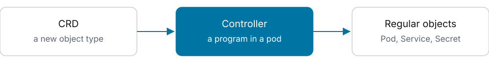

<p class="doing">The same desired-state loop. We have two operators: cert-manager and CloudNativePG.</p>

<!--
An operator isn't magic. It's two things.

First, a CRD, a custom resource definition. It adds a new object type to the cluster API, such as Certificate, or Cluster for a database.

Second, a controller, a regular program running in a pod. It watches objects of the new type and runs the loop from slide three: compare desired with real, and fix the difference.

The difference is that this controller knows the domain. It knows how to bring up a Postgres replica or how to obtain a certificate. Otherwise that knowledge would live in our scripts and in the head of whoever is on call.

The operators are installed from their official manifests, with versions pinned in the repository.
-->

---

## cert-manager

<p class="big">Obtains and renews TLS certificates.</p>

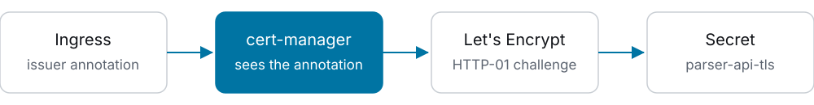

<p class="doing">We added one annotation. No Certbot, no cron.</p>

<!--
Here's how it works. The Ingress has a one-line annotation: cluster-issuer letsencrypt-prod. cert-manager sees it and creates a Certificate object.

Then it passes the Let's Encrypt domain check with an HTTP-01 challenge: for a short time it answers on port eighty through Traefik. It puts the certificate into the Secret parser-api-tls, and Traefik picks it up from there.

Before the certificate expires, cert-manager renews it by itself. In the main app, Certbot does this job.

ClusterIssuer is already one of the new object types: it describes where to get certificates.
-->

---

## CloudNativePG

<p class="big">We describe Postgres as one object.</p>

<div class="cols">
<div>

```yaml
kind: Cluster
metadata:
  name: parser-db
spec:
  instances: 2
  storage:
    size: 5Gi
```

</div>
<div>

### The operator creates

- 2 Postgres pods
- replication between them
- Service `parser-db-rw`
- Secret `parser-db-app`

</div>
</div>

<!--
On the left is a shortened version of our cluster.yaml file. Note the line kind: Cluster. This type doesn't exist in standard Kubernetes, the operator added it. Don't confuse it with a Kubernetes cluster: here it means a Postgres cluster.

We wrote: two instances, five gigabytes. On the right is what the operator builds from that: the pods, streaming replication, a Service that always points at the primary instance, and a Secret with the password.

The app knows none of this. It simply takes DATABASE_URL from the Secret.

The data sits in a regular directory on the node's disk, using local-path storage. That storage doesn't enforce the five gigabyte limit.
-->

---

## Failover

<p class="big">Primary down: the operator makes the standby the new primary.</p>

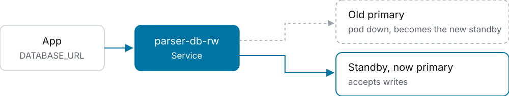

<p class="doing">The database address doesn't change. The latest commits can be lost.</p>

<!--
This is the reason to have a database operator.

The app connects through the Service parser-db-rw. When the primary pod fails, the operator promotes the standby to primary and switches the Service to it. The app changes nothing. The old pod later comes back as a standby.

Two caveats. Replication is asynchronous, so commits that haven't reached the standby yet can be lost. And this protects only against a pod failure. Both instances are on one machine, so if the machine fails, both stop.

You can test this yourself: delete the primary pod with kubectl and watch the cluster switch over.
-->

---

## The full request path

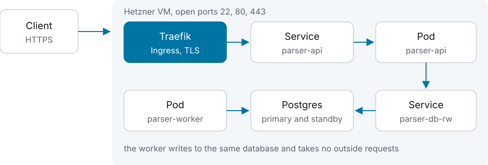

<!--
Let's put it all together. This is the whole system in one picture, and you now know every element in it.

A request arrives on port four hundred forty-three. Traefik terminates TLS with the certificate from cert-manager and, following the Ingress rule, sends the request to the Service parser-api. The Service finds the pod. The pod reaches the database through parser-db-rw, and that Service points at the current primary.

The worker is separate: it collects SAZ data and writes to the same database. It has no port.

The firewall allows three ports in. The Kubernetes API port is closed, and we'll come back to that.
-->

---

## Three layers, three workflows

<p class="big">Each layer is updated separately, through GitHub Actions.</p>

| Layer       | What it changes              | Workflow            | Approval     |
| ----------- | ---------------------------- | ------------------- | ------------ |
| Machine     | VM, firewall, k3s            | Provision Parser VM | required     |
| Platform    | operators, database, Secrets | Parser Platform     | required     |
| Application | api, worker, migrations      | Deploy Parser       | not required |

<p class="doing">The lower the layer, the less often it changes and the more a mistake costs.</p>

<!--
How does all this reach the server? There are three levels, each with its own workflow.

The bottom level: Terraform creates the virtual machine and the firewall. We run Terraform only from CI. First a plan, then an apply after approval. We don't do this from a laptop, because the state holds secrets.

The second level is the platform: operators, the namespace, the database. First a diff, then an apply after approval.

The top level is the application. It changes most often, so there's no approval here. Access rights provide the limits instead, and we'll get to those in two slides.
-->

---

## Deploying the application

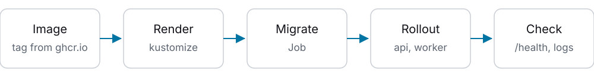

<p class="doing">Started by hand: a version and an environment. One deploy per environment at a time.</p>

<!--
Here's one run of Deploy Parser.

Step one: find the right image tag in ghcr.io. The image is built only when the parser code changes, so we take the newest release at or below the requested version.

Step two: kustomize assembles the final YAML from the base files and the environment settings. For staging, that's the domain, for example.

Then comes the migration as a Job, then the rollout, and finally the check: curl the health endpoint, which also verifies the certificate, and look in the worker logs for the line about connecting to the database.

Right now this is a manual start through Run workflow. There's no automatic start after a merge yet.
-->

---

## Cluster access

<p class="big">The Kubernetes API is closed to the internet.</p>

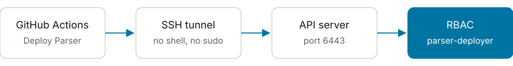

<p class="doing">Only the <code>parser</code> namespace. It can't read Secrets or change permissions.</p>

<!--
Port six thousand four hundred forty-three is closed in the firewall. The workflow comes in through an SSH tunnel as the user tunnel. That user has no shell and no sudo, and its key can only forward a connection to this one port.

Next comes RBAC, the permission system inside Kubernetes. Deploys use a separate identity, the service account parser-deployer. It sees only the parser namespace. A namespace is a named group of objects in a cluster.

The workflow checks this at the start with kubectl auth can-i. If an admin credential ends up in that secret by accident, the deploy stops.

One caveat: this isn't a full boundary for secrets. A pod started by this identity can mount any Secret in the parser namespace. That's why the namespace holds only the app's own secrets.
-->

---

## Current limits

<div class="cols">
<div class="card">

### Reliability

- one node: VM down, everything down
- no database backups yet
- data only on the VM's disk

</div>
<div class="card">

### Not done yet

- no live, staging only
- deploys start by hand
- no cluster monitoring

</div>
</div>

<!--
To be honest about what we don't have yet.

Everything is on one machine, so automatic failover protects only against a single pod failing. There are no parser-db backups yet, they're planned in issue seven hundred seventy-two. Recreating the machine deletes the data, so the server has delete protection in Terraform.

For live, the spec plans a separate machine with sixteen gigabytes. Cluster monitoring is also still ahead and needs its own decision.

All of this is acceptable for staging. For live, backups and monitoring are mandatory.
-->

---

## Glossary

<div class="terms">

| Term       | What it is                       |
| ---------- | -------------------------------- |
| Node       | a machine in the cluster         |
| Pod        | a running container, temporary   |
| ReplicaSet | keeps the right number of pods   |
| Deployment | an app version, updates its pods |
| Job        | a pod that's meant to finish     |
| Service    | a permanent address for pods     |
| Ingress    | a rule for incoming HTTP traffic |
| Secret     | passwords and keys for pods      |
| Namespace  | a named group of objects         |
| Operator   | a CRD plus a controller          |

</div>

<!--
This slide is for reference. You can leave it on screen during questions.
-->
