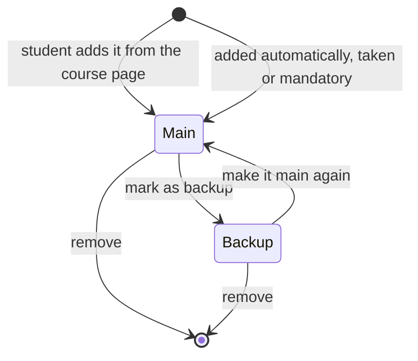
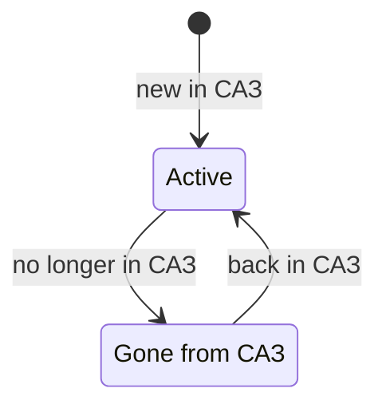
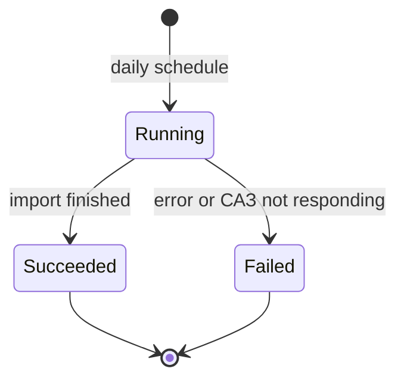

# Requirements Digest — MVP (ІНП planner + data/analytics enablers)

Scope: US-5.1, US-5.9, US-5.2, US-5.10a, US-5.10b, US-6.1, US-6.2, US-6.3, US-E.1, US-E.2, US-E.3, US-E.5, US-E.6.

## 1. Entities

| Entity | Definition | Key attributes | Relationships |
|---|---|---|---|
| Student (planner) | A user signed in with a NaUKMA corporate email. | id, email, programme_id, current_year_of_study, level (bachelor) | N:1 Programme; 1:1 ІНП Plan; 1:N Enrolment; 1:N Rating |
| Programme | The study programme of a student (e.g. "Комп'ютерні науки"). | id, name, level, total_credits (240), prof_oriented_min (54), free_choice_max (25) | 1:N Student; N:M Course via ProgrammeCourse |
| ProgrammeCourse | The type of a course in one programme. | programme_id, course_id, type (mandatory / profession-oriented / free choice), year_of_study (for mandatory) | N:1 Programme; N:1 Course |
| Course | A course from the САЗ catalog. | id, name, status (active / gone from САЗ), faculty | 1:N CourseTerm; 1:N Rating; 1:N PlanItem; N:M Programme |
| CourseTerm | One semester of a course, with its own credits and hours. | id, course_id, academic_year, semester (autumn / spring / summer), credits (decimal), weekly_hours (from САЗ) | N:1 Course |
| Enrolment | A course the student has already taken, according to САЗ. | student_id, course_id, academic_year, semester | N:1 Student; N:1 Course |
| ІНП Plan | The student's individual study plan (one per student). | id, student_id, created_at, updated_at | 1:1 Student; 1:N PlanItem |
| PlanItem | One course in the plan, placed in one year of study. | id, plan_id, course_id, year_of_study, role (main / backup), origin (taken / mandatory / added by student) | N:1 ІНП Plan; N:1 Course; 1..N CourseTerm of that year |
| Rating / Review | An existing anonymous rating (difficulty, usefulness) with optional text and the teacher(s) the reviewer says it is about (US-4.3). | id, course_id, student_id, difficulty 1–5, usefulness 1–5, text (optional), teachers (picked by the reviewer, optional) | N:1 Course; N:1 Student; N:M Teacher (picked by the reviewer) |
| DataUpdate | One daily data import from САЗ. | id, started_at, finished_at, status, course_count, previous_course_count | 1:N CourseChange |
| CourseChange | One change found by a data update. | id, update_id, course_id, kind (new / changed / removed), field, old_value, new_value | N:1 DataUpdate; N:1 Course |
| AnalyticsEvent | One tracked user action. | id, name (visit / course_page_opened / review_started / rating_submitted / add_to_inp / mark_as_backup …), visitor_id (always set: a random ID kept in the browser, the same before and after sign-in), student_id (optional, set once signed in), course_id (optional), occurred_at | N:1 Student (optional); N:1 Course (optional) |

Not stored, calculated each time the plan opens: credits per semester and year, weekly hours, programme totals, warnings.
Alerts to the data maintainer go through an external service and are not stored.

## 2. Lifecycles

### PlanItem

| From → To | Trigger | Condition |
|---|---|---|
| — → Main | Student adds the course from its page and picks a year | The course is not in the plan yet |
| — → Main | System, when the student opens the plan for the first time | The course is already taken (from САЗ) or mandatory in the programme |
| Main → Backup | Student marks it as backup | The student added it |
| Backup → Main | Student makes it main again | — (a limit warning may appear, but it does not block) |
| Main → removed | Student removes it | The student added it |
| Backup → removed | Student removes it | — |

Not allowed: removing a mandatory or taken course or marking it as backup; adding a course that is already in the plan; keeping a multi-semester course in only some of its semesters.

### Course (catalog status)

| From → To | Trigger | Condition |
|---|---|---|
| — → Active | Daily update | The course appears in САЗ for the first time |
| Active → Gone from САЗ | Daily update | The course is no longer in САЗ; it stays visible with its ratings |
| Gone from САЗ → Active | Daily update | The course is back in САЗ |

Not allowed: a data update deleting a course.

### DataUpdate

| From → To | Trigger | Condition |
|---|---|---|
| — → Running | Daily schedule | — |
| Running → Succeeded | Import job | Import finished; alert the maintainer if far fewer courses than last time |
| Running → Failed | Import job | Error or САЗ not responding; alert the maintainer |

Not allowed: a failed update changing what students see; restarting a finished update.

## 3. Business rules

| ID | Rule | Source |
|---|---|---|
| BR-01 | The student adds a course from its page and picks a year; the course goes to its semester(s) in that year. | US-5.1 |
| BR-02 | A course that runs over several semesters appears in each of them, with that semester's credits. | US-5.1 |
| BR-03 | If the course is in the plan, its page shows "Ваш курс вже додано в ІНП". | US-5.1 |
| BR-04 | The first time the plan opens, it already has the taken courses (from САЗ) and the mandatory courses for every year. | US-5.9 |
| BR-05 | The plan is shown by year and semester (autumn, spring, summer) with credits per semester; an empty semester shows 0. | US-5.9 |
| BR-06 | Credits can be decimal (e.g. 3.5), are set per semester, and are added up exactly. | US-5.9 |
| BR-07 | A backup stays in the plan but is not counted in credits, hours or rule checks. | US-5.2, US-6.2 |
| BR-08 | Removing a multi-semester course removes it from all its semesters. | US-5.10a |
| BR-09 | Credits of main courses per year (summer included) must be 58–62; otherwise show how many are missing or extra. | US-6.1 |
| BR-10 | Weekly hours come from САЗ; each semester may have at most 24 hours per week. | US-6.2 |
| BR-11 | For the whole bachelor programme: at least 54 profession-oriented credits and at most 25 free-choice credits. | US-6.3 |
| BR-12 | The plan shows the programme total out of 240 credits and how many are left. | US-6.3 |
| BR-13 | A course's type comes from the student's own programme. | US-6.3 |
| BR-14 | Breaking a limit shows a warning but never blocks the action. | US-6.1–6.3, US-5.10b |
| BR-15 | Course, semester and enrolment data are imported from САЗ every day, with no manual work. | US-E.1 |
| BR-16 | After an update, a student can rate a course that САЗ now shows they took. | US-E.1 |
| BR-17 | The maintainer gets an alert when an update fails or brings far fewer courses than last time, showing both counts. | US-E.2 |
| BR-18 | Each update has a summary of new, changed (old and new value) and removed courses, or "no changes". | US-E.3 |
| BR-19 | A course that disappears from САЗ is marked "gone from САЗ", not deleted, and students still see it with its ratings. | US-E.3 |
| BR-20 | The funnel counts visits → course page opened → review started → rating submitted for a period, with the % between steps; no % when a step is 0. Each step counts distinct `visitor_id`s (repeats by one visitor count once), and only visitors who also reached the previous step in that period, so every step is a subset of the one before. | US-E.5 |
| BR-21 | Feature actions (e.g. "add to ІНП", "mark as backup") are counted per day; 0 if nobody used them. | US-E.6 |

## 4. Prohibitions

| ID | Prohibition | Source |
|---|---|---|
| PR-01 | The system must never let a student remove a mandatory or taken course from the plan, or mark it as backup. | US-5.10a, US-5.2 |
| PR-02 | The system must never keep the same course twice in one plan. | US-5.1 |
| PR-03 | The system must never count a backup in credits, hours or rule checks. | US-5.2, US-6.2 |
| PR-04 | The system must never block adding a course or making a backup main because a limit is broken. | US-5.10b, US-6.2, US-6.3 |
| PR-05 | The system must never use a course's type from another programme. | US-6.3 |
| PR-06 | The system must never delete a course, rating or review because an update failed or the course left САЗ. | US-E.1, US-E.3 |
| PR-07 | The system must never send an alert for a normal update. | US-E.2 |
| PR-08 | The system must never count a review that was started but not sent as a submitted rating. | US-E.5 |
| PR-09 | The system must never show other users who wrote a rating. | NFR-S-002 |

## 5. Technical assumptions for MVP

| ID | Assumption |
|---|---|
| TA-01 | Sign-in uses the NaUKMA corporate email (already live, US-1.1); a session ends after 3 h without activity. |
| TA-02 | Rate UKMA entities (courses, plans, ratings…) use UUIDs, and the API accepts only UUIDs (e.g. `course_id`). Only the external parser service uses text IDs with a type prefix plus a ULID (e.g. `off_01JA…`). Both never change and mean nothing. САЗ codes are stored in separate `saz_*` columns. |
| TA-03 | Course, semester, credit, weekly-hour and enrolment data come only from САЗ, through the daily update. |
| TA-04 | A course's type in each programme comes from САЗ (`compulsory` / `prof_oriented` / `elective`). |
| TA-05 | Times are stored in UTC. A semester is two separate fields: the academic year (CourseTerm `academic_year`; in the API `academic_year_start`, e.g. `2026` for 2026–27) and the term, one of `FALL` / `SPRING` / `SUMMER` (CourseTerm `semester`; in the API `term`). |
| TA-06 | Each student has one ІНП plan; the credit rules are fixed for bachelor programmes (240 / 54 / 25 / 58–62 / 24 h). |
| TA-07 | A plan course uses the credits and hours from the latest academic year in САЗ. |
| TA-08 | Ratings and reviews are backed up every 24 h (NFR-R-004). |
| TA-09 | Not in MVP: several plan variants (US-5.11), linking a backup to its main course (US-5.3), ratings inside the plan (US-5.4), adding from the map (US-3.5), plan export and reminders (US-6.5–6.6), staff merging or splitting courses (US-E.4), free seats (US-2.7), rules for master's programmes. |
